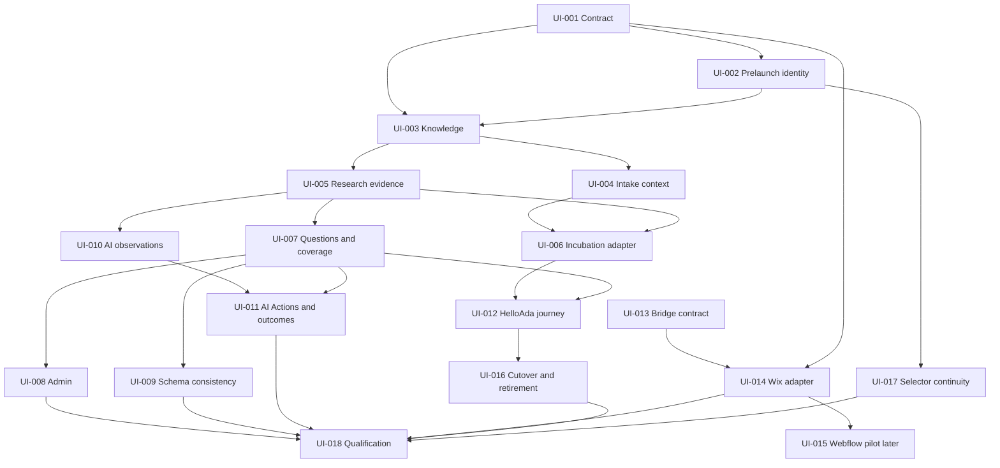

# Implementation plan

Status: proposed backlog, 2026-10-25. [Project board](https://github.com/users/weareheadless/projects/3).

Design considers the complete lifecycle. Delivery is phased; phase order does not postpone AI requirements or permit incompatible knowledge models.

Existing CrawlSEO #3 remains the initiative, #14 the narrower profile handoff, and Site-Agent #330 the existing migration workstream. New issues extend these rather than replacing history.

## Dependency map

The table is the complete dependency list; the diagram summarizes major edges.

## Work packages

| Work ID | Repo | Deliverable | Dependencies | Initial readiness |
| --- | --- | --- | --- | --- |
| [UI-001](https://github.com/weareheadless/crawlseo/issues/15) | crawlseo | Versioned contracts and compatibility fixtures | None | Ready: contract design |
| [UI-002](https://github.com/weareheadless/crawlseo/issues/16) | crawlseo | Support domainless intelligence projects and project-scoped jobs | UI-001 | Blocked by dependencies |
| [UI-003](https://github.com/weareheadless/crawlseo/issues/17) | crawlseo | Implement sourced business knowledge revisions and correction impact | UI-001, UI-002 | Blocked by dependencies |
| [UI-004](https://github.com/weareheadless/site-agent/issues/336) | site-agent | Map confirmed intake and accepted context to shared knowledge | UI-001, UI-003 | Blocked by dependencies |
| [UI-005](https://github.com/weareheadless/crawlseo/issues/18) | crawlseo | Centralize research requests and reusable source observations | UI-001, UI-002, UI-003 | Blocked by dependencies |
| [UI-006](https://github.com/weareheadless/site-agent/issues/337) | site-agent | Route incubation research through CrawlSEO and retire duplicate dispatch | UI-004, UI-005 | Blocked by dependencies |
| [UI-007](https://github.com/weareheadless/crawlseo/issues/19) | crawlseo | Link customer questions, business evidence and actual content coverage | UI-003, UI-005 | Blocked by dependencies |
| [UI-008](https://github.com/weareheadless/crawlseo/issues/20) | crawlseo | Expose inspectable intelligence and unify configuration writers | UI-003, UI-005, UI-007 | Blocked by dependencies |
| [UI-009](https://github.com/weareheadless/crawlseo/issues/21) | crawlseo | Audit schema semantics and visible business-content consistency | UI-003, UI-007 | Blocked by dependencies |
| [UI-010](https://github.com/weareheadless/crawlseo/issues/22) | crawlseo | Implement truthful AI access and visibility observation contracts | UI-001, UI-003, UI-005 | Blocked by dependencies |
| [UI-011](https://github.com/weareheadless/crawlseo/issues/23) | crawlseo | Turn AI citation gaps into shared Actions and measurable outcomes | UI-007, UI-010 | Blocked by dependencies |
| [UI-012](https://github.com/weareheadless/site-agent/issues/338) | site-agent | Carry shared intelligence through design, launch and ongoing execution | UI-004, UI-006, UI-007 | Blocked by dependencies |
| [UI-013](https://github.com/weareheadless/wix-site-bridge/issues/5) | wix-site-bridge | Reconcile generic bridge capabilities with CrawlSEO consumer expectations | None | Ready: inventory/contract |
| [UI-014](https://github.com/weareheadless/crawlseo/issues/24) | crawlseo | Qualify Wix execution adapter with exact effect approval and receipts | UI-001, UI-013 | Blocked by dependencies |
| [UI-015](https://github.com/weareheadless/crawlseo/issues/25) | crawlseo | Specify and qualify a bounded Webflow intelligence execution adapter | UI-001, UI-014 | Blocked by dependencies |
| [UI-016](https://github.com/weareheadless/site-agent/issues/339) | site-agent | Complete knowledge/research cutover and retire duplicate producers | UI-004, UI-006, UI-012 | Blocked by dependencies |
| [UI-017](https://github.com/weareheadless/helloada/issues/11) | helloada | Preserve one intelligence project identity across selector bootstrap and handoff | UI-002 | Blocked by dependencies |
| [UI-018](https://github.com/weareheadless/crawlseo/issues/26) | crawlseo | Qualify cross-repository intelligence journey and maintain release evidence | UI-008, UI-009, UI-011, UI-012, UI-014, UI-016, UI-017 | Blocked by dependencies |

## Phase gates

1. **Foundation:** approved contracts/fixtures, project-before-domain identity and source-preserving knowledge handoff. Bridge inventory can proceed independently.
2. **Research:** incubation requests and results cross the shared authority once; source controls and cost/retry behavior retain equivalence.
3. **Intelligence:** real question coverage, schema consistency, inspectable admin and explicitly scoped AI observations use the same knowledge/evidence model.
4. **Execution:** HelloAda and Wix prove exact candidate/effect review, receipts and current target verification. Webflow has its own later qualification.
5. **Migration and verification:** explicit authority transfer, redundant producer retirement, canary release and end-to-end evidence. No automatic customer cutover from a merge.

## Agent dispatch

Initially UI-001 and UI-013 can be picked up for contract/inventory work. Other issues are specified but blocked. Agents must recheck current dependencies and active PRs; do not infer readiness from this dated snapshot. Keep unresolved physical models/provider access as explicit contract-task outputs.

## Existing-work reconciliation

- CrawlSEO #14 already has an atomic research-profile implementation/test path in this baseline; inspect remaining Site-Agent handoff and tenant acceptance instead of rebuilding the endpoint.
- Site-Agent #330 and its migration gates remain applicable; UI-016 adds knowledge/incubation coverage and must link its actual cleanup work.
- Wix Bridge #3 remains the separation workstream; UI-013 must preserve it while qualifying generic capabilities.
- Track technical debt found outside these boundaries separately; do not turn the initiative into an unsolicited application rewrite.

## Completion rule

Each implementation issue provides reviewed code/contract evidence. UI-018 tracks integrated qualification, with separate platform gates and exact versions. A task may be merged while its platform remains unverified. Customer activation and spending/publication require existing explicit authority.
