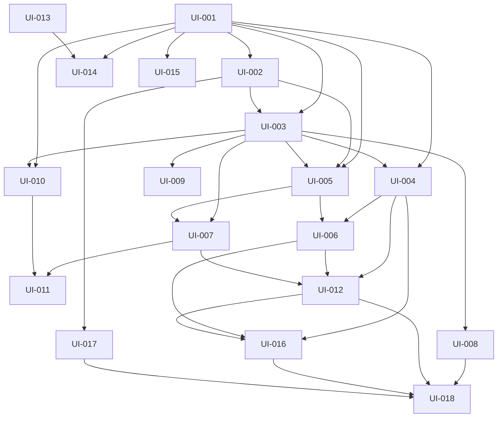

# Implementation plan

Reviewed design baseline v0.2, 2026-10-25. [Project board](https://github.com/users/weareheadless/projects/3).

Read the full design for context, then implement one bounded slice. AI requirements influence the shared model now; advanced monitoring and other platforms are not prerequisites of the first usable HelloAda flow.

## Smallest useful delivery

1. **Know and correct:** UI-001 -> UI-002/UI-003 -> UI-004/UI-008. Partial intake reaches one typed business document before design; an authorized admin corrects that same document. No provider integration needed to prove this.
2. **Research and answer:** UI-005/UI-006/UI-007 connect existing bounded research to one sourced customer question and an actual content target. No generalized knowledge graph or semantic search service.
3. **Use and prove:** UI-012/UI-016/UI-017 -> UI-018 prove one HelloAda content improvement, exact review/publication/readback, and restart-safe authority readiness. Do not rewrite the design/source pipeline.
4. **Independent follow-ups:** UI-009 schema, UI-010/UI-011 AI observations/outcomes, UI-014 Wix, UI-015 Webflow each qualify separately. Their absence is visible and does not fail the first slice.

UI-013 bridge inventory can run alongside UI-001 without customer effects. Webflow discovery waits for an explicit platform selection, not for Wix to be implemented.

## Dependency map

The following edges are generated from work-packages.json; native GitHub blocking relationships must match. Readiness is separate: Deferred work does not auto-start.

## Work packages

| Work | Repo | Bounded deliverable | Dependencies | Readiness |
| --- | --- | --- | --- | --- |
| [UI-001](https://github.com/weareheadless/crawlseo/issues/15) | crawlseo | Define the first shared knowledge handoff and compatibility fixtures | None | Ready |
| [UI-002](https://github.com/weareheadless/crawlseo/issues/16) | crawlseo | Register prelaunch projects without fake sites or Google prerequisites | UI-001 | Blocked by dependencies |
| [UI-003](https://github.com/weareheadless/crawlseo/issues/17) | crawlseo | Implement sourced business knowledge revisions and correction impact | UI-001, UI-002 | Blocked by dependencies |
| [UI-004](https://github.com/weareheadless/site-agent/issues/336) | site-agent | Map confirmed intake and accepted context to shared knowledge | UI-001, UI-003 | Blocked by dependencies |
| [UI-005](https://github.com/weareheadless/crawlseo/issues/18) | crawlseo | Centralize research requests and reusable source observations | UI-001, UI-002, UI-003 | Blocked by dependencies |
| [UI-006](https://github.com/weareheadless/site-agent/issues/337) | site-agent | Route incubation research through CrawlSEO and retire duplicate dispatch | UI-004, UI-005 | Blocked by dependencies |
| [UI-007](https://github.com/weareheadless/crawlseo/issues/19) | crawlseo | Link customer questions, business evidence and actual content coverage | UI-003, UI-005 | Blocked by dependencies |
| [UI-008](https://github.com/weareheadless/crawlseo/issues/20) | crawlseo | Expose a correctable business profile through existing admin services | UI-003 | Blocked by dependencies |
| [UI-009](https://github.com/weareheadless/crawlseo/issues/21) | crawlseo | Audit schema semantics and visible business-content consistency | UI-003 | Deferred |
| [UI-010](https://github.com/weareheadless/crawlseo/issues/22) | crawlseo | Implement truthful AI access and visibility observation contracts | UI-001, UI-003 | Deferred |
| [UI-011](https://github.com/weareheadless/crawlseo/issues/23) | crawlseo | Turn AI citation gaps into shared Actions and measurable outcomes | UI-007, UI-010 | Deferred |
| [UI-012](https://github.com/weareheadless/site-agent/issues/338) | site-agent | Carry shared intelligence through design, launch and ongoing execution | UI-004, UI-006, UI-007 | Blocked by dependencies |
| [UI-013](https://github.com/weareheadless/wix-site-bridge/issues/5) | wix-site-bridge | Inventory Wix bridge compatibility and define the smallest adapter contract | None | Ready |
| [UI-014](https://github.com/weareheadless/crawlseo/issues/24) | crawlseo | Qualify Wix execution adapter with exact effect approval and receipts | UI-001, UI-013 | Deferred |
| [UI-015](https://github.com/weareheadless/crawlseo/issues/25) | crawlseo | Specify and qualify a bounded Webflow intelligence execution adapter | UI-001 | Deferred |
| [UI-016](https://github.com/weareheadless/site-agent/issues/339) | site-agent | Complete knowledge/research cutover and retire duplicate producers | UI-004, UI-006, UI-012 | Blocked by dependencies |
| [UI-017](https://github.com/weareheadless/helloada/issues/11) | helloada | Preserve one intelligence project identity across selector bootstrap and handoff | UI-002 | Blocked by dependencies |
| [UI-018](https://github.com/weareheadless/crawlseo/issues/26) | crawlseo | Verify the first HelloAda content intelligence release | UI-008, UI-012, UI-016, UI-017 | Blocked by dependencies |

## Existing work and execution boundaries

- CrawlSEO #3 remains the parent initiative; #14 already has an atomic research-profile endpoint in the baseline. UI-004 extends the remaining handoff rather than rebuilding it.
- Site-Agent #330 remains the migration workstream. UI-016 implements import/fence/retirement readiness; UI-018 supplies the integrated proof before separate customer activation. These must not form a circular completion gate.
- [Site-Agent #252](https://github.com/weareheadless/site-agent/issues/252) is an existing exact source-maintenance review prerequisite. It blocks source effects, not a separately validated Payload content path. No source candidate may bypass it.
- Wix Bridge #3 retains tooling/customer-artifact separation. UI-013 inventories compatibility only; implementation of demonstrated gaps belongs in bounded linked UI-014 producer/consumer PRs.
- UI-008 ships the business editor after UI-003. Coverage/research/outcome views follow real records; no fake placeholders or new parallel profile store.

## Agent pickup

Initially UI-001 and UI-013 are Ready for contract/inventory work. Other first-slice tasks wait for direct dependencies. UI-009/UI-010/UI-011/UI-014/UI-015 are deliberately Deferred. A closed prerequisite does not promote Deferred work.

Read the owning issue, its relevant requirement sections and direct artifacts, not every historical architecture plan. Verify the current baseline and claim. Start with a small PR addressing the first unmet acceptance criterion; update the same issue for coherent follow-up PRs. Do not introduce a new service/framework or expand scope silently.

## Qualification and done

UI-018 can pass for the HelloAda content slice without AI monitoring or Wix/Webflow. Later capabilities report their own actual tests/pilots and remain unadvertised until qualified. Merged and Verified stay distinct. No coding issue implicitly authorizes paid research, customer migration or production effects.

No first-release exit criterion requires every long-term requirement to be implemented. Track each requirement as first-slice, later-owned, or execution-blocked with evidence. See [review.md](review.md) for simplifications and remaining uncertainty.
