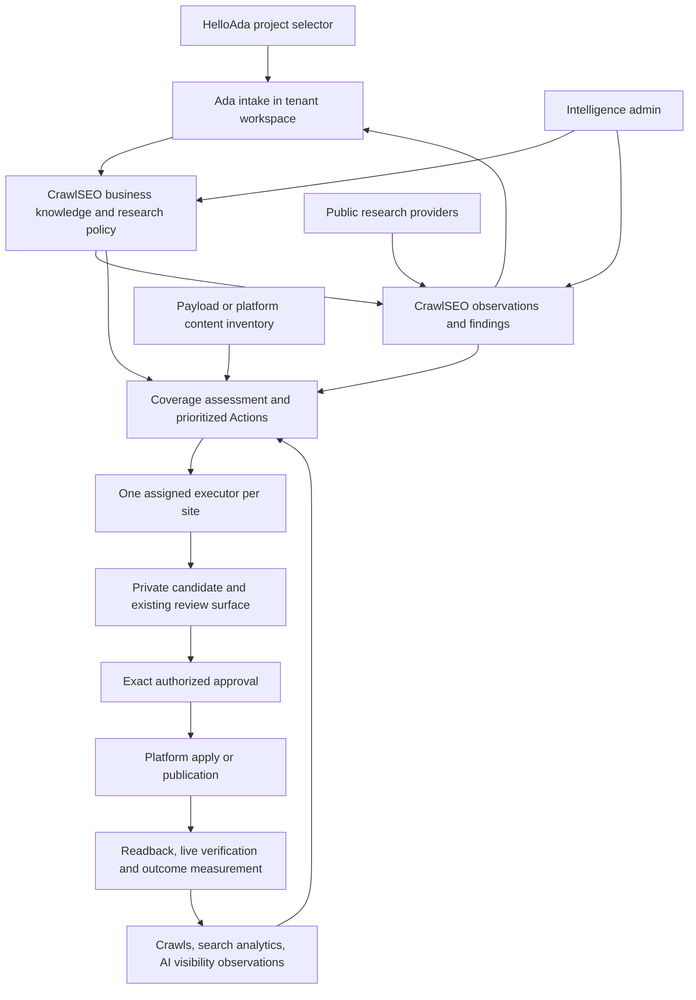

# Architecture specification

Version 0.2 — reviewed proposal, 2026-10-25. Baseline is [code-inventory.md](code-inventory.md).
Normative requirements use stable IDs. Proposed models and endpoints below are
new design, not claims about current capabilities.

## 1. Product outcome and boundaries

A business explains itself once. Ada uses public research to ask better
follow-up questions, then creates the website from the confirmed brief. The
same intelligence informs audits, content, local search and AI visibility.
Evidence-backed Actions reach the selected executor, which prepares a bounded
candidate, obtains the required approval, applies it, and reports verification.
Results inform subsequent research and recommendations.

The owner stays in the tenant workspace. CrawlSEO also exposes the intelligence
and its configuration to authorized admins, including users without HelloAda.
An admin can understand why Ada proposed a change and correct its inputs.

Included: prelaunch and existing businesses; services, locations, multilingual
markets, customer questions, research, crawl/search analytics, AI observations,
content coverage, administration, connectors and outcome feedback.

Excluded from centralization: CMS document ownership, private conversations,
design generation, full assets, enquiries, contacts, bookings, owner login,
platform secrets and infrastructure deployment. These retain existing owners.
GitHub coordinates engineering; it is not the customer approval authority.

### Minimal implementation and first release

The target model below describes the full product, not a requirement to build a
general-purpose knowledge graph or finish every platform before delivering value.
Use the existing Next.js/Postgres application, Prisma, jobs, outbox and connector
services. No new microservice, queue broker, vector database, workflow engine,
plugin framework or shared runtime package is required for the first release.

Start with a typed project business document and immutable revisions using the
existing intake shape and provenance. Keep offerings, audiences, locations and
claims as nested typed fields until independent queries justify separate tables.
Reuse ResearchRun/Source/Finding and ResearchAction; add only the smallest
project-scoped fields/records needed. Logical entities in section 4 are concepts,
not a table-per-entity mandate. Reuse the existing v1 execution envelope unchanged
unless a demonstrated capability cannot fit an additive, negotiated extension.

The first proof is: intake facts saved once -> the same facts can be inspected
and corrected in CrawlSEO -> one bounded sourced question returns to Ada -> one
supported content improvement uses those facts and the existing review path.
Start on a disposable project. Neither advanced schema auditing, multi-engine AI
monitoring, Wix nor Webflow is a dependency of that HelloAda proof. AI requirements
shape IDs, locale, evidence and observation boundaries now; provider integrations
are implemented only when a concrete supported surface and budget are established.

First make a correct whole-document revision refresh work. Identify relevant
changed field paths and recheck bounded pending work; do not build a generic
incremental dependency/invalidation graph. Add fine-grained optimization only
after correctness and an actual workload justify it. No autonomous agent fleet or
automatic issue-dispatch infrastructure is needed to implement these work packages.

## 2. System topology

CrawlSEO owns intelligence computation and Action identity. Site-Agent remains
Ada's conversational/design and HelloAda execution service. Wix Bridge owns
bounded Wix transport effects, not business research. A later Webflow adapter
uses the same contracts with independently proven platform capabilities.

## 3. Ownership and identity

| Domain | Authority | Consumer behavior |
| --- | --- | --- |
| Business knowledge revisions | CrawlSEO after explicit import/cutover | Intake and admin submit sourced corrections; task views read them |
| Conversation, assets, creative/relationship context | Site-Agent | Export necessary projections and opaque evidence references only |
| Research policy, collection, findings, question inventory | CrawlSEO | Ada requests work and reads results |
| Website content, draft/published document versions | Payload, Wix or Webflow | Export inventory and bounded content observations |
| Search/crawl/AI observations | CrawlSEO | Preserve provider origin, scope and observation time |
| Recommendation and Action state | CrawlSEO | Executors project one Action into their existing work UI |
| Candidate, review, approval and apply/publication | Assigned executor | Report immutable identities and receipts |
| Credentials | Existing protected platform/host resolver | Never serialize into intelligence or authoring prompts |

**ID-001:** A project exists before any domain, public Site or Google integration.
Use workspace/project IDs and unique external-origin mappings; domain is an
attribute, not a business identity. One project may attach multiple sites.
Different businesses can have similar names or shared hosting; never merge
tenants using domain/title similarity alone.

**ID-002:** A location is an actual business place; a service area is a coverage
claim. Model them separately, relate services to their availability, and support
online-only/not-applicable states. Locale consists of language and market,
with geography explicit rather than inferred from conversational wording.

**ID-003:** Every record and API operation is workspace/project scoped. Site-
specific effects additionally require exact site membership and binding.
Cross-project research reuse cannot expose private facts, excerpts or identifiers.

## 4. Knowledge contract

**KNOW-001:** Extend the existing profile/context boundary into a typed,
versioned knowledge service. Do not add a third independent editable profile.
Keep SiteProfile as a compatibility projection until readers migrate.

Logical entities (physical Prisma tables are an implementation design task):

| Entity | Minimum information and relationships |
| --- | --- |
| Business | Public/legal names where applicable, aliases, description, official URLs, contact channels |
| Offering | Service/product, audience, availability, pricing conditions when known, restrictions, differentiators |
| Audience segment | Buying situation, needs, motivations, objections and desired outcomes |
| Location / Service area | Explicit type, address/coverage, relevant offerings, locality evidence |
| Claim | Bounded factual statement, supporting evidence, publication permission and applicability |
| Knowledge revision | Changed fields, predecessor, actor/source, reason, validity and provenance |
| Question | Wording/variants, intent, segment, offering, locale, evidence, priority and unanswered inputs |
| Research observation / Finding | Immutable source snapshot or bounded excerpt; sourced interpretation and uncertainty |
| Content observation / Coverage link | Exact document/URL revision and section answering a question or supporting a claim |
| Visibility observation | Question-set revision, engine/surface/locale, raw-result reference, extracted mentions/citations |
| Action / Execution binding | Required change, input revisions, dependencies, exact target and current executor |
| Outcome | Publication anchor, baseline/window, measurements, attribution limits and data completeness |

**KNOW-002:** Per-field provenance includes origin system/record/revision,
actor, recorded/observed time, source reference and status. Distinguish owner
statement, admin statement, website observation, public evidence and model
inference. Owner-confirmed is not synonymous with independently verified.
Unknown, disputed, deferred and not-applicable are explicit states.

**KNOW-003:** Evidence approval does not mean publication permission. Private
pricing, internal strategy or customer stories may inform planning without being
publishable. Keep visibility/usage policy alongside each relevant fact/reference.

**KNOW-004:** Writes require expected revision and content-bound idempotency key.
Preserve immutable revision history. A stale edit conflicts; a repeated exact
write returns the original result. Imports retain old IDs and hashes.

**KNOW-005:** Business, policy and content revisions are separate. Expose bounded
views for intake/design/editorial/research/strategy. Pin exact consumed revisions
on research runs, assessments and candidate review packages.
An incomplete working intake can inform research before a design run exists;
it must not replace a pinned accepted brief. Candidate content uses facts approved
for that use, retaining their real actor/origin. A draft hypothesis never becomes
an approved business claim merely because its snapshot was synchronized.

**KNOW-006:** A correction identifies affected questions, coverage links and
Actions. Reassess pending work whose inputs changed; do not rewrite history,
relabel public findings, silently mutate approved packages, or republish content.

## 5. Intake, incubation and initial website

**INTAKE-001:** Reuse DesignIntakeDraft and its provenance/confirmation workflow.
The selector creates identity and hands into the canonical tenant admin; no
second owner intake in HelloAda's selector or CrawlSEO.

**INTAKE-002:** Collect a short viable brief first. Track launch readiness
separately from research/growth completeness. Ask follow-ups only for missing
inputs consequential to the next operation. A service area, evidence-backed
claim or pricing question may be deferred without blocking unrelated design.

**INTAKE-003:** Once a useful offer/audience context exists, submit one bounded
research request to CrawlSEO, carrying intake/knowledge revision and question
intent. Preserve current feed trust, source approval/exclusion, language and
limits. Results flow into the existing advisor briefing with durable source IDs.
The request must not trigger design, publication or paid work without policy.

**INTAKE-004:** Confirmed briefs become immutable business knowledge revisions.
The design pipeline composes those with Site-Agent's local creative context.
Initial content should use known customer questions and supported business
answers; unresolved statements remain visible rather than invented.

**INTAKE-005:** Validate the private candidate's content bindings, question
coverage, fact consistency, metadata, relevant schema and links. A private
preview is not an indexable launch. After existing exact owner approval and
verified publication, attach/verify the canonical origin and schedule a baseline
public crawl. Analytics absence must not block business research.

**INTAKE-006:** Existing-site onboarding imports observations as unconfirmed,
maps canonical pages/documents, confirms only necessary facts, and joins the same
knowledge/research/Action journey without rebuilding or repeating intake.

## 6. Research and customer understanding

**RES-001:** All current research producers use one project authority and budget.
Migrate incubation collection as well as Growth/keyword/article producers.
Retain specialized provider jobs and domain synthesis; do not force all research
through one prompt or remove useful source controls.

**RES-002:** Persist research intent, purpose (incubation, audience, competitor,
keyword, article, AI visibility), knowledge/policy revisions, locale, providers,
planned queries, exclusions, limits, costs and result quality. Provider capability
must be truthful: unsupported/unavailable/partial are observable states.

**RES-003:** Separate stable source identity from immutable observations. Preserve
canonical URL, provider ID, retrieved/published dates where available, content
hash, bounded excerpt, usage restrictions and language. Reuse sufficiently fresh
authorized observations across requests; changed content produces new evidence.
Do not dedupe unrelated posts by title alone or refresh dates without fetching.

**RES-004:** Findings reference actual evidence and retain contradictions.
Reddit posts indicate expressed concerns, not verified market facts. A single
anecdote is not a trend. Comment-thread depth is an explicit provider capability;
RSS collection must not claim comprehensive Reddit conversation analysis.

**RES-005:** Normalize related question variants with traceable merge decisions;
keep intent, segment, offering, market/language and geographic scope. Combine
GSC queries, public research, intake questions and later AI grounding queries.
Do not collapse distinct audiences or buying situations into a generic keyword.

**RES-006:** Treat evergreen business evidence differently from time-sensitive
news. Retain historical observations while applying purpose-specific freshness
to new decisions. Existing stricter execution freshness remains until a versioned
contract change is implemented; this proposal does not relax current gates.

## 7. Content coverage, SEO and local visibility

**CONTENT-001:** Assess actual bounded page content and headings/sections against
questions and claims, using CMS revisions or crawl observation hashes. URL/title
lists are candidate discovery, not proof of coverage. Report stale, missing,
conflicting, partial and supported answers distinctly.

**CONTENT-002:** Prefer an appropriate existing section/page. Create a new page
only when audience intent, supporting knowledge and site architecture justify
it. Share Action identity/dedupe across research, GSC, crawl and AI signals.
Duplicate observations enrich evidence without changing an approved package.

**CONTENT-003:** Location recommendations require true availability and local
value (projects, constraints, coverage details, appropriate testimonials).
City-name substitution and paraphrasing are not unique evidence. Service areas
must not generate invented offices or addresses.

**SCHEMA-001:** Parse all supported markup representations, especially JSON-LD
objects, arrays and @graph, with explicit invalid/unsupported results. Detect
entity/type conflicts and relevant missing fields. Presence is not validity.

**SCHEMA-002:** Compare visible content and verified business inputs to markup;
support breadcrumbs and appropriate organization/business/service/article types.
Generate markup and visible answers from shared content fields where possible.
Never add fake reviews, qualifications, locations or invisible FAQ answers.

**SEO-001:** Keep crawlability/indexability, canonicals, internal links, robots,
sitemap, rendering and performance checks linked to content/Action evidence.
Indexing problems require diagnosis; they do not prove thin content by themselves.
Minification is a platform limit concern, not a central growth strategy.

## 8. AI visibility capabilities designed from the outset

**AI-001 — Access:** Check robots/indexing directives, HTTP/canonical state,
rendered text and, when supplied, CDN/WAF and verified crawler logs. A spoofed
user-agent fetch alone cannot establish real crawler access. Report absent log
access and provider-specific uncertainty.

**AI-002 — Answer usefulness:** Use the shared question/coverage model to propose
direct, helpful answers, comparisons, constraints, examples and current supported
facts. Distinguish improvements to access, answer quality and authority; adding
schema is not evidence of a citation gain.

**AI-003 — Observation protocol:** Version question sets with wording, purpose,
brand aliases, competitors, language, geography and cadence. Store each engine,
product surface, model/version when reported, time, browsing mode, prompt and
bounded response/source references. API model output is not a measurement of
the consumer product unless the provider explicitly supplies that surface.

**AI-004 — Measurement:** Extract brand mentions, recommendations, linked
citations and cited URLs separately. Aggregate only comparable observations;
show sample size, unavailable runs and repeated observations. Zero citations in
one sample is not proof of no visibility. No universal opaque AI visibility score.

**AI-005 — Provider ingestion:** Prefer authorized first-party reports; otherwise
use documented supported providers or clearly labelled manual imports. Verify
export/API availability and permissions before promising automation. Do not
scrape authenticated consumer experiences or bypass access restrictions.

**AI-006 — Opportunities:** Relate observed cited sources and unanswered questions
to business expertise and actual page coverage. Recommendations to improve
evidence, gain appropriate third-party references or answer questions remain
testable hypotheses. External outreach requires its own explicit authorization.

**AI-007 — Outcomes:** Keep citations/mentions, referral sessions and conversions
separate. Show baseline and follow-up windows, changed question-set/engine
conditions, seasonality and insufficient-data states. GSC aggregate traffic must
not be labelled isolated Google AI traffic. Do not promise causality or rankings.

Google documents no special AI schema requirement; structured data must match
visible content. FAQ rich-result eligibility is restricted, not a universal
business growth tactic. Google's Indexing API is not a bulk-indexing tool for
ordinary service pages. Bing AI reports cover their documented experiences, not
all AI engines. See section 15 for primary sources.

## 9. Explainable administration

**ADMIN-001:** CrawlSEO exposes Business knowledge, Research strategy, Questions
and coverage, Recommendation evidence, Execution policy and Outcomes. HelloAda
may expose the same records through its workspace; never add independent writers.

**ADMIN-002:** Every significant edit shows current source/status, proposed diff,
validation and affected work. Record actor/reason and immutable revision. Admin
corrections are admin statements, not fictitious owner confirmations. Provide
evidence/rationale summaries, not hidden model reasoning.

**ADMIN-003:** Enforce separate project read, knowledge write, research-policy,
spend-policy and execution permissions. Ordinary profile editors cannot broaden
credentials, transfer executor ownership or approve publication. Reuse existing
tenant authentication and strengthen shared ownership checks where necessary.

**ADMIN-004:** Display freshness, unavailable capabilities, current input revisions,
missing information, next actor and real work status. Model priority/confidence
is not quality proof; show the documented components and supporting evidence.
Prompt/model diagnostics belong in operator detail, not mandatory owner setup.

## 10. Actions, preparation and execution

**EXEC-001:** Reuse ResearchAction and the existing revisioned connector lifecycle.
An Action includes problem, recommendation, evidence refs, relevant questions/
claims, input revisions, target identity, expected outcome, required capabilities,
dependencies, acceptance criteria, priority basis and reassessment conditions.
An Action without a supported executable target becomes a request for information
or labelled analysis; it must not be forced into a fabricated candidate.

**EXEC-002:** One active executor per site with generation fencing. Keep binding
transfer explicit; settle outstanding events, reservations and owner decisions.
An engine outage cannot cause a second executor or local research fallback.

**EXEC-003:** Preparation eligibility is not publication approval. Bind preparation
to Action revision, generation and attempt ID. Bind review/approval to exact
candidate reference, authenticated review destination and package hash. Recheck
current knowledge, content and evidence before candidate creation/application.

**EXEC-004:** Candidates report bounded changes, changed targets, validation and
rollback limitations. Publication receipts identify each actual effect, target,
content hash and time. Verification separates API readback, live render and later
outcome measurements. Partial application is not success.

HelloAda's existing candidate path must be proven for the selected effect, not
assumed correct because it exists. Source-maintenance review has an existing
[Site-Agent #252 prerequisite](https://github.com/weareheadless/site-agent/issues/252).
Until its exact render/review gates are met, source effects stay blocked. The
first intelligence slice uses the independently validated Payload content path;
it does not reopen or redesign the source/design pipeline. Missing proof for
that content path is an explicit blocker at verification, not a prompt workaround.

**EXEC-005:** Wix capabilities are per-operation, not a blanket `wix` permission.
Custom Embeds, Wix Blog, CMS, SEO tags and source code have different authorities
and permissions. An embed can become live immediately: treat embed apply as a
publication effect requiring its exact review, even without a separate publish.
Preserve human-only Editor placement/publication restrictions where configured.

**EXEC-006:** Code publication and snippet updates are non-atomic. Record phases
and uncertain effects, reconcile before retry, preserve intervening edits, and
use existing private snapshots. Code rollback, CMS rollback and snippet rollback
are distinct capabilities. Do not invent atomicity or automatic code rollback.

**EXEC-007:** Webflow begins with capability discovery and a bounded pilot. Model
CMS staged/live state and platform publication scope explicitly; do not assume
publishing one change affects only one item. Unsupported effects stay blocked.
No automatic Webflow publication until its review/receipt/readback path is proven.

## 11. Integration, reliability and spending

**API-001:** Extend the existing connector application services with versioned
project-level bootstrap/knowledge/research operations; preserve v1 site execution.
Proposed logical operations: project registration, knowledge read/CAS write,
research request/status, finding/question reads, inventory observation, coverage
assessment, AI observation ingestion, existing Action/events/status operations.
Specify request/response schemas, capabilities, scopes, bounded cursors, errors
and compatibility fixtures before implementation. Do not create a universal
plugin framework or expose direct arbitrary publication instructions.

**API-002:** Event outbox/inbox delivery is at-least-once. Stable IDs and revisions,
durable receipt before acknowledgement, bounded backoff, replay/reconciliation
and failure diagnostics are required. Handle duplicates and out-of-order events
without losing work or regressing state. Tenant-scoped sequencing is not an
authorization token. Reads never trigger collection or publication.

**API-003:** Use one monetary reservation/settlement ledger per project, separate
from run counts, source limits and provider rates. Account for AI sampling and
synthesis costs as well as paid SEO research; introduce per-operation bounds.
Reserve before dispatch, settle receipts, retain uncertain holds. Currency/timezone
and permission changes cannot reset spend. No permission is implied by intake.

**API-004:** Keep private content/owner messages outside public provider queries
unless explicitly allowed. Source text and model output are untrusted data;
cannot grant capabilities, change project, reveal secrets or expand scope.
Enforce SSRF protections and redact diagnostics. Use bounded retention/export/
deletion rules with provenance tombstones where needed; do not retain private
data indefinitely merely to preserve an audit link.

## 12. Lifecycle and compatibility

Business lifecycle: collecting -> confirmed -> live -> maintained; confirmation
does not imply public release. Research can run before live under policy.
These labels describe the journey; derive them from existing identity, intake and
publication records rather than adding an independent lifecycle engine.

Research: requested -> queued -> collecting -> synthesizing -> completed/partial/
blocked/failed. An unavailable provider is not an empty successful research run.

Action/preparation/execution remain separate existing state machines. Map UI
status to their real records; do not replace them with one ambiguous `done`.

**MIG-001:** Add an explicit knowledge-authority transition alongside existing
research/execution authority. Before transfer, import accepted context with
source mappings and compare bounded reads. Freeze the old writer, reconcile
pending edits/work/spend, then activate the canonical writer with revision fencing.
Retain historic snapshots as read-only lineage, not editable competing truth.

**MIG-002:** Maintain v1 compatibility while adding new contracts; consumers must
advertise supported versions/capabilities. Additive changes are optional until
negotiated. Breaking meaning requires a new version and fixtures in producer and
consumer CI. No customer cutover from documentation or schema deployment alone.

**MIG-003:** Inventory every producer, scheduler, prompt, setting, route and caller
with retain/migrate/delete disposition. Delete redundant writers and collectors
only after replacement equivalence and tenant acceptance; preserve historical
readers and immutable receipts. Restart/outage tests must not resurrect producers.

**MIG-004:** Canary-first rollout through each repository's existing exact-SHA
release mechanism. No direct tenant deployments or production config changes in
this architecture initiative. Failed rollout pauses dispatch and reconciles effects;
rollback does not silently resume independent paid research.

## 13. Acceptance and observability

**ACCEPT-001:** A disposable prelaunch business completes intake -> sourced pain
point -> confirmed answer -> Ada-generated candidate -> exact owner review ->
approved publication -> baseline crawl -> one improvement Action -> executor
candidate -> publication receipt -> live verification -> outcome observation.
All stages resolve to one project and explicit input/content revisions.
This gate is for the first supported HelloAda content slice; schema expansion,
AI sampling and other platforms have independent acceptance gates and do not
block this proof. Track later capability qualification without claiming universal
platform completion.

**ACCEPT-002:** Repeat with an existing site, an owner correction, a failed provider,
stale edit, duplicate event, interrupted publication and a transferred executor.
Assert cross-project denial, no duplicate paid work/candidates and preserved
approvals. Do not use a real customer as an implicitly authorized test target.

**ACCEPT-003:** A separate Wix pilot proves supported effects and manual blockers;
Webflow remains unadvertised until its own pilot. API/hash checks alone do not
prove visible content. Publish only under actual target authorization.

Measure knowledge completeness by purpose, provenance coverage, question/coverage
quality on labelled fixtures, repeated-source reuse, unsupported-claim and duplicate
Action rates, cost per usable finding, event lag, preparation failure/partial-effect
rates and verified outcomes. Select numeric release thresholds from an initial
labelled baseline; do not invent performance proof from model confidence.

## 14. Decisions and unresolved implementation details

Decided proposal: one intelligence authority, existing UI/execution owners,
project-before-domain identity, typed provenance and shared question inventory,
AI capabilities designed into the data model, exact effect approval preserved.

Contract task must settle: physical model/migration shape, external-origin
uniqueness, field status enum mapping, project credential bootstrapping, new scope
names, retention periods and source reuse policy. AI provider task must settle
available integrations, allowed surfaces and cost bounds. These are explicit
dependencies, not permission to fabricate working endpoints or providers.

UI-001 settles only the first-slice wire contract and migration shape before
coding. It records future AI/question/source envelope requirements but does not
specify every future API/provider in advance. Later work extends the reviewed
contract through concrete fixtures. The initial admin editor needs business
knowledge and existing policy records, not a completed question-coverage engine.

## 15. Primary external references

- [Google AI features and websites](https://developers.google.com/search/docs/appearance/ai-features)
- [Google structured-data policies](https://developers.google.com/search/docs/appearance/structured-data/sd-policies)
- [FAQ rich-result restrictions](https://developers.google.com/search/blog/2023/08/howto-faq-changes)
- [Indexing API eligible uses](https://developers.google.com/search/apis/indexing-api/v3/quickstart)
- [Bing AI Performance scope](https://www.bing.com/webmasters/help/ai-performance-9f8e7d6c)
- [GitHub Projects practices](https://docs.github.com/en/issues/planning-and-tracking-with-projects/learning-about-projects/best-practices-for-projects)

Verify external provider contracts again when implementing; this spec does not
claim an API exists merely because a reporting dashboard exists.
